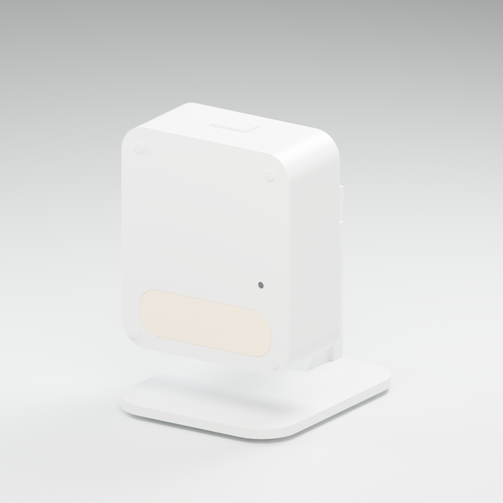

# 眠光 · 毫米波睡眠监测与夜灯

面向老年人睡眠场景的非接触工程样机，采用 DFRobot C1001 60 GHz 雷达、Seeed XIAO ESP32C3 和外接暖白限流灯板。白色简约外壳兼容桌面支座与壁挂安装。

## 项目目录

| 文件夹 | 内容 | 入口 |
|---|---|---|
| [pcb/](pcb/) | 嘉立创EDA工程、原理图、PCB、BOM、Gerber、坐标和检查程序 | [PCB设计说明](pcb/README.md) |
| [firmware/](firmware/) | ESP32固件、雷达协议、监测与夜灯算法、日志工具、测试及编译产物 | [编译与使用](firmware/README.md) |
| [models/](models/) | V0.2 Blender模型、11个STL、4张效果图、尺寸依据及检查程序 | [模型说明](models/README.md) |
| [platform/](platform/) | 多设备管理平台MVP应用、联网适配、部署工具与开发文档 | [平台设计入口](platform/README.md) |
| [docs/](docs/) | 方案书PDF/DOCX、版本说明和历史复核记录 | [文档索引](docs/README.md) |
| [research/](research/) | 官方资料、选型依据、尺寸图、参考STEP与厂商库 | [资料索引](research/README.md) |
| [tools/](tools/) | 文档生成等项目辅助脚本 | [工具说明](tools/README.md) |

## 当前交付

- **PCB V0.3 PRECHECK 03，2026-11-05：** [在线DFM上传ZIP](pcb/preflight_v03/Mianguang_V0.3_DFM_PRECHECK_03.zip)、[嘉立创完整工程](pcb/release_v03_precheck03/Mianguang_V0.3.epro2)、[完整BOM](pcb/release_v03_precheck03/BOM_Mianguang_V0.3.xlsx)、[SMT专用BOM与坐标](pcb/preflight_v03/smt_precheck03/)、[修订与装配说明](pcb/release_v03_precheck03/README_交付与装配.md)。依据用户回传的02版在线报告修正机械孔表达、丝印避让及线宽。原理图/PCB严格DRC均零问题，[独立验收49/49](pcb/release_v03_precheck03_acceptance.json)、[制造几何40/40](pcb/release_v03_precheck03_fabrication.json)通过。孔位、器件位置及钻孔后实际铜图形未变。**03版在线复检和SMT检查待完成；8条插件到贴片间距提示按后续手工焊接条件保留，尚未制造放行。**
- **PCB V0.2 历史冻结版，2026-11-04：** [原完整交付ZIP](pcb/releases/眠光雷达_PCB_V0.2_2026-11-04.zip)保持字节不变。该版PCB DRC零错误、独立验收44/44通过；原理图保留的排针属性警告已在 V0.3 关闭。
- **固件 V0.2.0：** [源码](firmware/src/)、[固定构建配置](firmware/platformio.ini)、[编译产物及校验](firmware/releases/v0.2.0/)。已完成目标板编译和模拟测试，未烧录实机。
- **外壳 V0.2，2026-11-04：** [Blender模型](models/v0.2/Mianguang_Enclosure_V0.2.blend)、[11个STL](models/v0.2/stl/)、[壁挂预览](models/v0.2/renders/03_wall_45deg.png)、[爆炸预览](models/v0.2/renders/04_exploded.png)。按冻结PCB对齐四孔和23个元件，补充雷达固定、按钮、灯板、USB压条及共用转轴；桌面0–30°、壁挂0–45°。数字几何检查见[检查记录](models/v0.2/geometry_checks.json)，采购尺寸约束和实物待验项见[装配说明](models/mechanical/assembly_v02.md)。
- **管理平台MVP：** 仓库已合并平台应用、联网适配和部署工具，见[平台入口](platform/README.md)、[软件交付状态](platform/docs/delivery.md)、[联网固件](platform/firmware/README.md)。软件及短时合成检查与现场验收分开记录；三台真机24小时、持续负载与机构实际部署仍待完成。

首次接线请阅读[交付与装配说明](pcb/release_v03_precheck03/README_交付与装配.md)。USB烧录前断开外部5 V，取下JP1、JP2和JP3。夜灯使用5 V自带限流、功率不超过0.5 W的灯板。当前雷达通信需确认供电后人工执行 `radar on`；自动掉电禁能、脱机自动启动和整夜实测尚未完成。

V0.3的两域原生检查已没有保留提示；02版在线报告已归档并据此修订，03版仍须重新上传PCB DFM及SMT检查，首件实测尚未完成。软件回放采用合成数据；当前输出用于有效测量区间内的趋势观察，未建立医疗诊断有效性。

## 版本与校验

`pcb/release_v02/`及PCB完整ZIP保持已验收字节，原有SHA-256可直接复核。交付说明中原工作区的 `hardware/` 对应本仓库的 `pcb/`。固件源码、二进制及原始构建清单保持对应，说明文档补充了V0.2载板操作要求。

2026-10-28的方案书保留早期设计记录，当前PCB状态以[PCB入口](pcb/README.md)及[LATEST.json](pcb/LATEST.json)为准；V0.3 PRECHECK02源快照保留在`pcb/release_v03/`，不能与03版混用。第三方字体、厂商代码及资料来源见[第三方资料说明](THIRD_PARTY_NOTICES.md)。

外壳最新文件集中于 `models/v0.2/`；早期 `Concept.blend`、根目录下的旧STL和旧渲染仅保留为历史记录。本次外壳迭代未更改冻结PCB和固件交付。结构模型按明确的器件包络检查，尚未经过实物装配、射频、照明温升或承载测试。

本次分类后的文件与测试复核记录见[仓库迁移检查](verification/README.md)。
