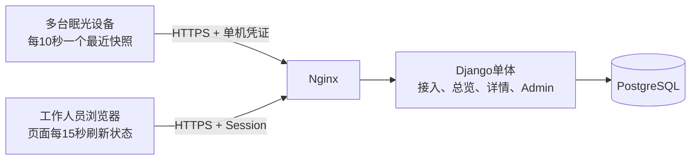

# 眠光多设备管理平台 · MVP

设计基线：2026-11-04；对接 PCB V0.2 / 固件 V0.2.0。平台实现独立放在本目录：`app/` 为 Django 单体，`contracts/` 为接入契约。已发布硬件、模型和固件保持原版本；当前固件尚不能联网，平台模拟结果不代表真机结果。

## 实现状态

| 阶段 | 当前交付 |
|---|---|
| M1 数据接入 | [PR #1](https://github.com/wonderbench/mianguang/pull/1) 已合并；迁移、鉴权、幂等/顺序、绑定事务、模拟器及 PostgreSQL 并发验证 |
| M2 管理闭环 | [PR #2](https://github.com/wonderbench/mianguang/pull/2) 已合并；两角色、Admin、总览、历史趋势、受限 CSV 与审计 |
| M3 真机接入 | 尚未实施联网固件；没有三台真机24小时结果 |
| M4 运行交付 | `deploy/` 提供三容器、网络边界、日清理、加密备份与隔离恢复；CI 合成冒烟结果以仓库工作流为准，实际机构部署与容量验收仍待执行 |

实际部署入口为 [运行与恢复](docs/operations.md)。开发文档中的100台/24小时、605万行查询性能和生产恢复RTO/RPO均是验收目标，不是本轮达成数据。

## 开发运行

需要 Python 3.12 和 PostgreSQL 17；不提供 SQLite 替代配置。依赖完整锁定于 `requirements.txt`（含哈希），直接依赖记录于 `requirements.in`。

```sh
cd platform
python3.12 -m venv .venv
.venv/bin/pip install --require-hashes -r requirements.txt
export DJANGO_SECRET_KEY="$(.venv/bin/python -c 'import secrets; print(secrets.token_urlsafe(48))')"
export DJANGO_DEBUG=true DJANGO_ALLOWED_HOSTS=localhost,127.0.0.1
export PGHOST=127.0.0.1 PGPORT=5432 PGDATABASE=mianguang PGUSER=mianguang
# PGPASSWORD 由本机受控环境提供，不写入仓库。
.venv/bin/python app/manage.py migrate
.venv/bin/python app/manage.py init_roles
.venv/bin/python app/manage.py createsuperuser
.venv/bin/python app/manage.py runserver 127.0.0.1:8000
```

专用演示数据库可设置 `DEMO_MODE=true`，在另一个终端运行三设备模拟器：

```sh
DEMO_MODE=true .venv/bin/python app/manage.py simulate_devices \
  --url http://127.0.0.1:8000 --allow-local-http --actor admin --count 3 --duration 60
```

模拟器每次新登记带“模拟”标记的设备/床位，经过绑定隔离期后通过真实 HTTP 入口上报当前快照；默认要求 HTTPS，本地 HTTP 必须显式启用且仅允许回环地址。它不会修改实机配置，令牌不打印到日志。此命令的延迟是客户端请求耗时，不等同于容量验收中的服务端处理耗时。

本地及 CI 验证使用 PostgreSQL：

```sh
.venv/bin/python tools/validate_contract.py
DJANGO_SETTINGS_MODULE=config.test_settings .venv/bin/python app/manage.py check
DJANGO_SETTINGS_MODULE=config.test_settings .venv/bin/python app/manage.py test monitoring.tests
```

`config.test_settings` 只为隔离测试关闭 HTTPS 重定向并使用测试密码哈希；不能作为部署配置。数据库测试账号需要创建测试库的权限。GitHub Actions 使用独立 PostgreSQL 服务执行迁移检查及少量跨层回归。

### 管理与查看

访问 `/login/` 登录总览，访问 `/admin/` 管理地点、床位、设备和账号。管理员将人员加入“平台管理员”或“查看员”分组；查看员可见本部署全部床位，不能进入后台或导出。普通平台管理员不能修改超级管理员账号或密码。

在后台登记设备后，凭证只在当次页面显示。设备列表的“绑定 / 解绑 / 轮换 / 停用”入口执行统一事务；换人或换床前应先在现场停止使用，完成后更新设备配置并重启。绑定列表可打开已结束的历史绑定；历史住户代号和地点快照不能直接编辑。

总览每15秒刷新，浏览器会独立检查30秒观测过期和60秒无新上报，即使轮询失败也不会保留旧的有效测量。绑定详情提供1/8/24小时和最近7天内自选UTC窗口，分别显示上报完整度、RR/HR有效点比例。分钟缺点或无效时曲线断开；CSV仅管理员可导出，带有效性、原因、原始值和模拟标记，并记录导出范围与行数。

首版面向一个社区服务团队或疗养院的一组床位：让工作人员知道设备装在哪里、是否持续上报、最近观测是否可用，并查看单床趋势。采用 **Django 单体 + PostgreSQL + HTTPS 主动上报**；业务页面由服务端生成，复用 Django Admin 管理基础资料。

## 首版只交付这五项

| 功能 | 最小结果 |
|---|---|
| 账号 | 管理员、查看员两种角色；一套部署服务一个机构，账号可见本部署全部床位 |
| 设备与床位 | 地点、房间/床位、设备登记；绑定、解绑、换人、停用；保存绑定历史 |
| 总览 | 按地点筛选，显示最近上报、待现场启用、无新上报、测量不可用、最近在床观察及灯状态 |
| 单床详情 | 当前绑定、最近状态、最多24小时的RR/HR观测曲线、上报缺口与有效点比例；查看最近7天内任一24小时窗口 |
| 运维 | 设备凭证轮换、管理员CSV导出、关键变更审计、备份与过期清理 |

“待检查”由当前状态计算，不另建报警中心、工单或通知队列。首版不做 SaaS 多租户、跨机构账号、手机应用、远程开灯/启用雷达、OTA、MQTT、微服务、Redis、Celery、时序数据库和数据仓库。不输出疾病报警、深睡时长、睡眠评分或真实离床次数；这些能力没有被当前硬件与算法验证。

## 最小运行形态



以 **10–100台设备、10个同时查看会话**为设计与压测目标，不是已证实容量。100台约10次写入请求/秒；一台虚机、三个容器即可开始验证。现场先用3台真机验证，不因模拟压测通过就直接承担夜间无人值守照护。

## 阅读顺序

1. [技术架构与页面范围](docs/architecture.md)：系统边界、技术选择、状态与页面。
2. [设备接入契约](docs/device_protocol.md)：身份、时间、幂等、绑定与质量规则。
3. [数据模型和接口](docs/data_api.md)：最少数据表、事务及读写接口。
4. [固件接入改造](docs/firmware_integration.md)：已有能力、缺口与实际源码依据。
5. [开发计划和验收](docs/development.md)：按可演示结果分步实施。
6. [部署与运维](docs/deployment.md)：网络、权限、容量、保留与备份。

[JSON Schema](contracts/telemetry.schema.json)和[合成样例](examples/)用于后续联调，不是实测资料。[文档复核](docs/review.md)记录本轮一致性检查；外部技术依据在[来源与决策](docs/sources.md)。

设计阶段的[协议文档自检](docs/validation.json)覆盖36个正反例及当时的本地文件链接，只验证文档产物。当前实现继续复用这一检查，另由 CI 运行数据库集成测试与容器部署/恢复冒烟。可在上述虚拟环境中运行以下命令复核契约，不连接服务器或设备：

```sh
python platform/tools/validate_contract.py
```

现有固件没有 Wi-Fi/HTTPS/UTC 上报，并且重启后仍需现场确认供电、安装与光照。平台登录、设备绑定或网络恢复均不能替代这些确认。首版是有人值守的工程试点；无人值守恢复属于后续硬件与启动策略验证范围。
