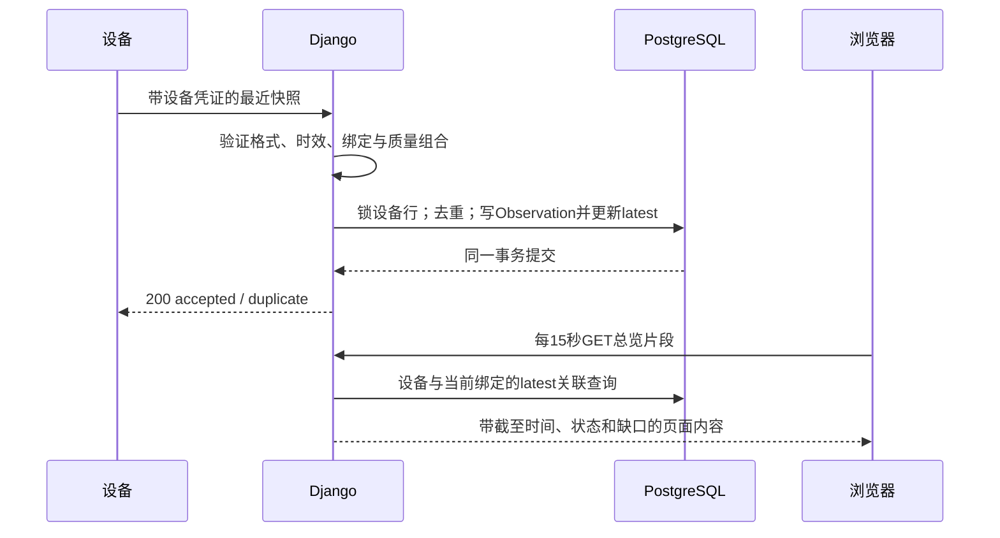

# 最小技术架构

状态：设计待开发，2026-11-04。范围以[平台入口](../README.md)为准。

## 1. 部署和技术选择

| 层 | 首版决定 | 原因 |
|---|---|---|
| 后端 | Python 3.12、Django 5.2 LTS、Gunicorn | 一套应用复用认证、Session、ORM、迁移、Admin和模板；不另外引入DRF |
| 页面 | Django Templates + 少量原生JavaScript + 本地CSS | 两个业务页面，15秒同源轮询；无前后端分离、打包工具或WebSocket |
| 曲线 | 原生SVG，接口给1分钟显示桶 | 24小时最多1440点；缺失断线，不通过平滑伪造测量 |
| 数据 | PostgreSQL 17 | 事务、条件唯一约束和JSON字段满足小规模设备记录；无独立时序库 |
| 接入 | 设备每10秒主动HTTPS POST一次 | 仅上传，无远程命令；减少消息代理及其鉴权、运维 |
| 入口 | Nginx、TLS证书、访问限流 | 同一个域名分设备入口和人员入口；数据库不暴露公网 |
| 定时工作 | 宿主机定时器调用管理命令、备份工具 | 仅每日清理与备份；无常驻任务队列或调度服务 |

开发开始时锁定上述系列中仍受支持的补丁版本、依赖哈希和镜像摘要；本轮不虚构已生成的锁文件。Django 5.2 的延长支持到2028年4月，版本选择依据见[官方支持表](https://www.djangoproject.com/download/)。PostgreSQL的大版本与补丁维护依据[官方版本政策](https://www.postgresql.org/support/versioning/)。

一个部署对应一个机构。`Site` 只是该机构内部地点，例如楼栋、社区服务点；房间/住户单元存为床位的文字字段。跨机构隔离采用独立部署与数据库，不增加租户表、共享租户数据库或跨租户权限框架。一个部署内查看员能够看到全部床位，试点授权必须与这一范围一致。

## 2. 应用内部边界

一个 Django 项目、一个业务应用 `monitoring`。按函数拆职责，不按服务拆系统：

- `ingest_telemetry()`：凭证核验、契约校验、绑定校验、幂等写入、更新设备最新记录。
- `replace_binding()` / `disable_device()` / `rotate_credential()`：事务化管理动作，同时写审计。
- `read_overview()` / `read_binding_history()`：只读查询，统一派生展示状态和统计。
- `purge_expired()`：批量保留清理；数据库备份另用 `pg_dump`。

这些函数由设备接口、业务页面或Admin调用。Admin不能绕过领域函数直接改绑定、密钥或历史记录。没有消息总线、通用插件系统、规则引擎或独立鉴权服务。

设备网络任务不参与本机夜灯决策。平台故障时现场灯控和雷达查询应保持原有行为；这个约束需在联网固件中测试，不是当前已实现能力。

## 3. 两个业务页面和管理入口

**总览 `/`**：地点过滤、床位/住户代号、设备编号、最近采集/接收时间、连通状态、工作状态、最近在床观察、RR/HR最近有效值、灯模式/亮度。顶部显示已绑定设备数、待现场处理数、无新上报数；设备数统计互斥的连通状态，工作异常另计并标明可重叠。点击进入当前绑定详情。

**绑定详情 `/bindings/<uuid>/`**：只显示该次绑定历史。提供过去1小时、8小时、24小时，以及最近7天内自选最多24小时窗口，起止对齐UTC整分钟（默认结束取服务端当前分钟起点）。曲线画有效原始快照的1分钟显示桶，展示报告缺口、有效点比例和最近故障原因。结束的绑定显示“历史”，没有当前灯状态。无数据时显示缺失原因，不填0。管理员可导出该绑定同一时间窗口的原始CSV。

**管理 `/admin/`**：账号、Site、Bed、Device和绑定动作；未绑定设备的诊断状态也在管理页查看。凭证只在创建/轮换后显示一次，不提供可回读密钥页面。无需另写一套基础资料CRUD前端。

## 4. 连通、工作状态和测量各自表达

下列判断使用服务端当前UTC；先判断连通，再判断工作条件，最后判断各测量。字段无效或过期时仍可显示“最近失败原因”，但不沿用旧的有效值填充现在。

| 维度 | 判定 / 文案 |
|---|---|
| 管理停用 | `Device.enabled=false` → 停用；没有在线承诺 |
| 从未收到新鲜唯一包 | 待首次上报；绑定切换后也回到此状态 |
| 无新上报 | 距最后新鲜唯一包接收 **>60秒** → “超过60秒无新上报”；不称设备断电 |
| 观测过期 | 距该包接收 **>30秒**，或采集时间距现在 **>30秒** → “观测已过期”，测量及占用unknown |
| 最近快照可显示 | 上述两个年龄都≤30秒；未来偏差在契约范围内时显示采集时间，并标明是“最近观测” |
| 待现场处理 | `radar_enabled=false`→待启用；否则`installation_confirmed=false`→待安装确认；否则`ready=false`→启动/模式确认中；否则`transport_ok=false`→雷达通信异常 |
| 测量状态 | 即使工作条件均正常，RR/HR也各自按`valid`和量程检查；活动、无人、离床等会使体征不可用 |

页面同源请求失败或标签页恢复后，先把超过30秒的旧数据变为过期；不让静止的旧绿色卡片冒充新上报。页面每15秒请求一次，因此状态呈现可滞后一个刷新周期；不承诺即时报警。

占用状态：presence/bed两者均有效且为1→“最近在床”；均有效、bed=0且presence为0或1→“最近非在床”；任一无效或presence=0且bed=1→unknown。在床不等于睡着，非在床不等于需要急救。P0不统计状态跳变次数，也不把灯亮当作离床事件。

## 5. 统计口径

统一按UTC对齐的10秒时隙。指定绑定与`[from,to)`窗口，先裁剪至绑定存在且完成5秒隔离的区间，仅完整落在区间内的时隙进入分母；每个时隙选择`captured_at`最新的一条，遇相同采集时刻按接收顺序与主键确定唯一记录。停用/解绑会结束绑定，不把已结束后的时间当作设备应上报时间。

- **上报完整度**：有快照的时隙数 / 应有时隙数；分母为0返回null。
- **RR/HR有效点比例**：相应字段有效的代表点数 / 有快照的时隙数；无快照返回null。两个比率同时展示，避免断网期间少量有效点被描述为整夜100%覆盖。
- **曲线显示桶**：每UTC分钟的6个时隙中，只有6个都存在且相应字段都有效才画该分钟最后一个代表值；其余为null并断线。返回`received_slots`与各自`valid_slots`供解释。此规则保守且确定，不额外做插值、滚动中位数或健康评分。

各字段的`age_ms`和`valid`保留原意；连续快照中重复出现的同一缓存读数可能影响点比例，因此点比例只说明平台看见的快照质量，不能叫独立雷达采样率或持续有效时长。不要把10秒快照直接交给现有仅允许≤2秒间隔积分的离线摘要程序。
